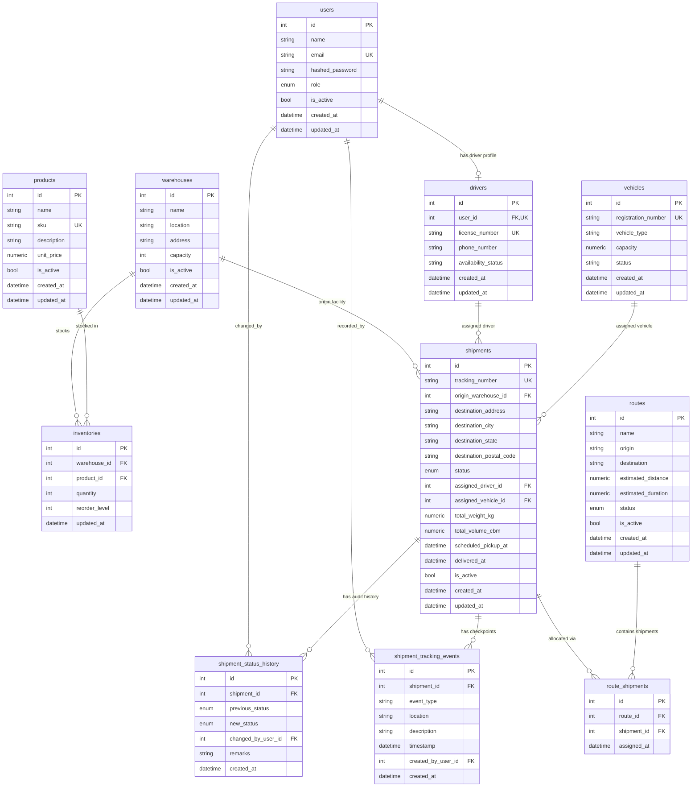
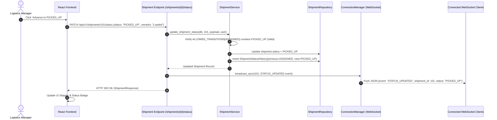

# FlowGrid — System Architecture Specification
**Decoupled Monolith with Real-Time Telemetry & Layered Backend Governance**

*Document Version:* 1.0.0  
*Status:* Verified & Authoritative Baseline  
*Last Updated:* October 2026  
*Primary Technical Reference:* FlowGrid Core Codebase (`backend/` & `frontend/`)

---

## Table of Contents
1. [Architecture Overview](#1-architecture-overview)
2. [Verified Technology Stack & Versions](#2-verified-technology-stack--versions)
3. [High-Level System Architecture Diagram](#3-high-level-system-architecture-diagram)
4. [Frontend Architecture](#4-frontend-architecture)
5. [Backend Architecture & Request Lifecycle](#5-backend-architecture--request-lifecycle)
6. [Database Architecture & Entity Relationships](#6-database-architecture--entity-relationships)
7. [Authentication & Authorization Subsystem](#7-authentication--authorization-subsystem)
8. [API Design & Route Catalog](#8-api-design--route-catalog)
9. [Major Operational Workflows (Mermaid Diagrams)](#9-major-operational-workflows)
10. [Integration Boundaries & External Dependencies](#10-integration-boundaries--external-dependencies)
11. [AI-Ready Data Pipeline & Risk Intelligence Architecture](#11-ai-ready-data-pipeline--risk-intelligence-architecture)
12. [Error Handling, Logging, Testing & Validation](#12-error-handling-logging-testing--validation)
13. [Local Development & Configuration Management](#13-local-development--configuration-management)
14. [Deployment Architecture](#14-deployment-architecture)
15. [Architectural Decisions, Trade-Offs & Known Limitations](#15-architectural-decisions-trade-offs--known-limitations)
16. [Architectural Extension Guidelines](#16-architectural-extension-guidelines)

---

## 1. Architecture Overview

FlowGrid is engineered as a **modular decoupled monolith** consisting of:
1. **Frontend Client**: A responsive single-page application (SPA) built with **React 19** and **Vite**, utilizing native HTML5, JavaScript, Leaflet mapping, and custom vanilla CSS design tokens.
2. **Backend Application**: An asynchronous, high-throughput RESTful API and WebSocket server built with **FastAPI** (Python 3.11+ / 3.14 compatible).
3. **Persistence Layer**: Relational data store running **PostgreSQL** in production (and in-memory **SQLite** for rapid isolated unit testing) managed declaratively via **SQLAlchemy 2.0** ORM and versioned through **Alembic** migrations.
4. **Real-Time Telemetry Hub**: An in-memory, thread-safe asynchronous **WebSocket ConnectionManager** supporting real-time broadcast of checkpoint telemetry and status updates.
5. **AI Data Pipeline & Risk Engine**: An isolated analytical subsystem extracting PII-redacted features, enforcing anti-leakage quarantine rules, and calculating deterministic, explainable delay-risk scores.

The architecture enforces a strict **layered separation of concerns**:
```text
HTTP Request / WebSocket
       │
       ▼
[ Middleware & Security Headers ] (Latency, CORS, Security)
       │
       ▼
[ FastAPI Routers ] (Input Parsing, Pydantic Schema Validation)
       │
       ▼
[ Dependencies Layer ] (JWT Decoding, RBAC Role Enforcement, DB Session)
       │
       ▼
[ Service Layer ] (State Machine Invariants, Business Rules, Allocations)
       │
       ▼
[ Repository Layer ] (Optimized Queries, Filters, Soft-Deletes)
       │
       ▼
[ SQLAlchemy ORM Models ] (Entity Declarations, Relationships, Table Mappings)
       │
       ▼
[ PostgreSQL Database ] (ACID Compliance, Indexes, Foreign Key Constraints)
```

---

## 2. Verified Technology Stack & Versions

All technologies and libraries have been verified directly from `backend/requirements.txt` and `frontend/package.json`:

### 2.1 Backend Environment
| Layer | Technology | Version Range / Pinned | Operational Purpose |
| :--- | :--- | :--- | :--- |
| **Runtime** | Python | 3.11+ (verified on 3.14.6) | Asynchronous backend execution runtime |
| **Web Framework** | FastAPI | `>=0.110.0, <1.0.0` | High-performance ASGI framework, automatic OpenAPI schemas |
| **ASGI Server** | Uvicorn (`[standard]`) | `>=0.28.0, <1.0.0` | Lightning-fast ASGI HTTP & WebSocket server |
| **Validation & Settings** | Pydantic / Pydantic-Settings | `>=2.6.0, <3.0.0` / `>=2.2.0` | Request/response schemas, `.env` parsing, type safety |
| **ORM & Data Layer** | SQLAlchemy | `>=2.0.0, <3.0.0` | Modern 2.0 declarative mapping, type annotations, connection pooling |
| **Database Driver** | psycopg (`[binary]`) | `>=3.1.18` | Official psycopg 3 driver for PostgreSQL |
| **Schema Migrations**| Alembic | `>=1.13.0, <2.0.0` | Repeatable version-controlled database schema migrations |
| **Password Hashing** | pwdlib (`[argon2]`) | `>=0.2.0` | State-of-the-art Argon2id password hashing |
| **JWT Cryptography** | PyJWT | `>=2.8.0` | HMAC-SHA256 access token encoding, decoding, validation |
| **Test Suite** | pytest / pytest-anyio | `>=8.0.0` | Automated test runner (278 backend tests) |
| **HTTP Client** | HTTPX | `>=0.27.0, <1.0.0` | Async HTTP client for FastAPI TestClient integration |

### 2.2 Frontend Environment
| Layer | Technology | Version Range / Pinned | Operational Purpose |
| :--- | :--- | :--- | :--- |
| **UI Framework** | React / React-DOM | `^19.2.8` | Component rendering, state hooks, reactive UI |
| **Build & Dev Tool** | Vite | `^8.3.0` | Instant HMR, optimized production asset bundling |
| **Geographic Maps** | Leaflet | `^1.9.4` | Interactive route maps, waypoint visualization |
| **CSS Styling** | Vanilla CSS | Custom Design System | CSS variables, Deep Tech Blue theme (zero Tailwind bloat) |
| **Code Quality** | Oxlint | `^1.81.0` | High-speed JavaScript linter |
| **Testing** | Node.js Test Runner | Native (`node --test`) | Fast unit/integration test runner (43 frontend tests) |

---

## 3. High-Level System Architecture Diagram

```mermaid
graph TB
    subgraph "Client Layer (Browser)"
        UI[React 19 SPA (Vite)]
        LeafletMap[Leaflet OpenStreetMap]
        WSClient[WebSocket Telemetry Client]
    end

    subgraph "FastAPI Backend (Port 8000)"
        MW[Security & Timing Middleware]
        CORS[CORS Handler]
        AuthRouter["/api/v1/auth (Argon2 / JWT)"]
        ShipmentRouter["/api/v1/shipments"]
        TrackingRouter["/api/v1/shipments/{id}/tracking"]
        WSEndpoint["/ws/tracking/{shipment_id}"]
        AnalyticsRouter["/api/v1/analytics"]
        PipelineRouter["/api/v1/pipeline"]
        FleetRouters["/warehouses, /products, /inventory, /drivers, /vehicles, /routes"]

        subgraph "Application Core Services"
            ShipmentSvc[ShipmentService: State Machine]
            RiskSvc[DelayRiskService: Deterministic 0-100]
            TrackingSvc[TrackingService: Milestones]
            ConnMgr[ConnectionManager: WebSocket Hub]
            AnalyticsSvc[AnalyticsService: KPIs]
            PipelineSvc[DatasetGenerator & QualityChecker]
        end

        subgraph "Repository Data Access Layer"
            ShipmentRepo[ShipmentRepository]
            TrackingRepo[TrackingRepository]
            AnalyticsRepo[AnalyticsRepository]
            CoreRepos[Warehouse, Product, Inventory, Driver, Vehicle Repositories]
        end
    end

    subgraph "Persistence Layer"
        PG[(PostgreSQL 15+ / SQLite in tests)]
    end

    UI -->|HTTP Bearer JWT| MW
    WSClient -->|WS Protocol + JWT| WSEndpoint
    MW --> CORS
    CORS --> AuthRouter & ShipmentRouter & TrackingRouter & AnalyticsRouter & PipelineRouter & FleetRouters
    WSEndpoint --> ConnMgr
    ShipmentRouter --> ShipmentSvc
    TrackingRouter --> TrackingSvc
    AnalyticsRouter --> AnalyticsSvc & RiskSvc
    PipelineRouter --> PipelineSvc
    FleetRouters --> CoreRepos

    ShipmentSvc --> ShipmentRepo
    ShipmentSvc --> ConnMgr
    TrackingSvc --> TrackingRepo
    TrackingSvc --> ConnMgr
    AnalyticsSvc --> AnalyticsRepo
    RiskSvc --> ShipmentRepo & CoreRepos
    PipelineSvc --> CoreRepos

    ShipmentRepo & TrackingRepo & AnalyticsRepo & CoreRepos --> PG
    UI -.->|Render Coordinates| LeafletMap
```

---

## 4. Frontend Architecture

The frontend is structured under `frontend/src/` with clear functional boundaries:

### 4.1 Entry Point & Component Bootstrap
- [`main.jsx`](file:///c:/Users/saksh/OneDrive/Pictures/Documents/FlowGrid/frontend/src/main.jsx): Bootstraps the React DOM root and mounts `<App />`.
- [`App.jsx`](file:///c:/Users/saksh/OneDrive/Pictures/Documents/FlowGrid/frontend/src/App.jsx): Root container providing Context Providers (`AuthProvider`, `ToastProvider`, `NotificationProvider`) and rendering `AppContent`.

### 4.2 Lightweight Client-Side Routing
Rather than introducing heavy third-party routing packages, FlowGrid implements a native, lightweight client-side routing mechanism in [`App.jsx`](file:///c:/Users/saksh/OneDrive/Pictures/Documents/FlowGrid/frontend/src/App.jsx#L34-L115):
- Evaluates `window.location.pathname` on startup (`getInitialRoute()`).
- Supports routes: `'dashboard'`, `'warehouses'`, `'inventory'`, `'drivers'`, `'vehicles'`, `'shipments'`, `'routes'`, `'login'`, `'register'`.
- Synchronizes navigation state with browser history using `window.history.pushState` and listens to browser navigation events via `popstate`.
- Automatically enforces authentication state: unauthenticated visitors are redirected to `'login'`; authenticated visitors accessing `'login'` are redirected to `'dashboard'`.

### 4.3 State Management & Context Architecture
State is managed hierarchically through specialized React Contexts and Custom Hooks:
1. **`AuthContext`** ([`src/context/AuthContext.jsx`](file:///c:/Users/saksh/OneDrive/Pictures/Documents/FlowGrid/frontend/src/context/AuthContext.jsx)):
   - Stores current `user` object and `token`.
   - Persists JWT in browser `localStorage` under `flowgrid_access_token`.
   - Exposes `login()`, `register()`, and `logout()` helpers.
2. **`ToastContext`** ([`src/context/ToastContext.jsx`](file:///c:/Users/saksh/OneDrive/Pictures/Documents/FlowGrid/frontend/src/context/ToastContext.jsx)):
   - Global feedback notification toaster (`success`, `error`, `info`, `warning`).
3. **`NotificationContext`** ([`src/context/NotificationContext.jsx`](file:///c:/Users/saksh/OneDrive/Pictures/Documents/FlowGrid/frontend/src/context/NotificationContext.jsx)):
   - In-app notification center tracking status transitions, low-stock alerts, and exception severity.
4. **`useDashboardData`** ([`src/hooks/useDashboardData.js`](file:///c:/Users/saksh/OneDrive/Pictures/Documents/FlowGrid/frontend/src/hooks/useDashboardData.js)):
   - Asynchronously coordinates parallel data fetching for dashboard overview, recent shipments, warehouses, routes, and inventory metrics with automatic polling and manual refetch.
5. **`useTrackingWebSocket`** ([`src/hooks/useTrackingWebSocket.js`](file:///c:/Users/saksh/OneDrive/Pictures/Documents/FlowGrid/frontend/src/hooks/useTrackingWebSocket.js)):
   - Manages WebSocket connection lifecycle (`CONNECTING`, `OPEN`, `CLOSING`, `CLOSED`), automatic reconnection with exponential backoff, ping-pong keepalives, and event dispatches.

### 4.4 Page & Component Inventory
- **Pages (`src/pages/`)**: `ShipmentsPage`, `WarehousesPage`, `InventoryPage`, `DriversPage`, `VehiclesPage`, `RoutesPage`.
- **Core Viewport Components**:
  - `Sidebar.jsx`: Collapsible navigation with brand identity and active route indicators.
  - `TopNavbar.jsx`: Shows active user profile, role badge, live backend connectivity pill (`healthy` / `disconnected`), and notification bell.
  - `ShipmentDetailDrawer.jsx`: High-density operations drawer (73KB) featuring 4 dedicated tabs:
    1. *Overview*: Freight specs, driver/vehicle allocations, quick status advancement buttons.
    2. *Tracking Telemetry*: Real-time WebSocket connection state, live event log, checkpoint creation modal.
    3. *Audit History*: Chronological table of state machine transitions with remarks and timestamps.
    4. *Delay Risk*: Deterministic risk meter (0–100), severity badge, and factor-by-factor explanation breakdown.
  - `ShipmentRouteMap.jsx` & `RouteMapPanel.jsx`: OpenStreetMap visualization using Leaflet showing origin hubs, transit corridors, and destination points.
  - `DataTable.jsx`: Reusable sorting, pagination, and empty-state presentation table.
  - `RoleGate.jsx` & `RoleBadge.jsx`: Visual RBAC indicators disabling or hiding unauthorized actions.

---

## 5. Backend Architecture & Request Lifecycle

The backend resides in `backend/app/` following clean architecture principles:

### 5.1 Main Entry Point (`backend/app/main.py`)
- Initializes `FastAPI` instance with comprehensive OpenAPI metadata, tags, and Swagger configuration.
- Instantiates **Security Headers & Timing Middleware**:
  - Measures request latency in milliseconds (`X-Process-Time-Ms`).
  - Sets security hardening headers: `X-Content-Type-Options: nosniff`, `X-Frame-Options: DENY`, `X-XSS-Protection: 1; mode=block`.
  - Injects `Strict-Transport-Security` in production.
- Configures `CORSMiddleware` supporting origins defined in settings.
- Registers global exception handlers:
  - `SQLAlchemyError`: Logs complete trace internally and returns sanitized HTTP 500 JSON.
  - `Exception`: Generic catch-all preventing internal runtime stack traces from leaking to clients.
- Registers modular sub-routers:
  - Sub-router `api_router` mounted at `/api/v1`.
  - WebSocket router `ws_tracking_router` mounted at `/ws/tracking/{shipment_id}`.
  - Root endpoints: `/health` (liveness probe), `/health/db` (database connectivity probe), and `/` (API greeting).

### 5.2 Layered Modular Structure
```text
backend/app/
├── api/
│   ├── deps.py               # Reusable FastAPI dependencies (get_db, get_current_user, require_roles)
│   └── v1/
│       ├── api.py            # API v1 Router aggregator
│       └── endpoints/        # Modular controller endpoints (auth, shipments, warehouses, etc.)
├── core/
│   ├── config.py             # Pydantic Settings (.env configuration)
│   ├── logging.py            # Structured logging configuration
│   └── security.py           # Cryptographic primitives (Argon2id hashing, JWT token encode/decode)
├── db/
│   ├── base.py               # DeclarativeBase model registry
│   └── session.py            # Engine initialization, connection pooling, get_db generator
├── models/                   # Pure SQLAlchemy 2.0 ORM models
├── schemas/                  # Pydantic validation schemas (Create, Update, Response, Filters)
├── repositories/             # Data access layer (CRUD queries, filters, joins)
├── services/                 # Core domain business logic (State machine, Risk scoring, WebSockets)
└── pipeline/                 # AI-ready data pipeline (FeatureExtractor, QualityChecker, Exporter)
```

### 5.3 Service Layer Responsibilities
- **`ShipmentService`**: Enforces the `ALLOWED_TRANSITIONS` state machine, validates weight against vehicle capacity, verifies driver/vehicle availability, generates collision-free tracking numbers, and coordinates atomic status history recording.
- **`DelayRiskService`**: Evaluates active shipments and calculates explainable delay-risk scores (0–100) based on unassigned assets, vehicle capacity strain, interstate geography, and warehouse inventory congestion.
- **`TrackingService`**: Appends audit status transitions, records physical checkpoint events, and constructs consolidated tracking responses.
- **`ConnectionManager`**: Thread-safe manager handling WebSocket connections grouped by `shipment_id`, enforcing per-shipment (50) and global (1,000) caps to prevent socket exhaustion.
- **`AnalyticsService`**: Orchestrates KPI calculation across shipments, warehouses, inventory, drivers, vehicles, routes, and risk categories.

---

## 6. Database Architecture & Entity Relationships

The relational database architecture is defined in `backend/app/models/` and managed through Alembic.

### 6.1 Entity-Relationship Diagram (Mermaid)



### 6.2 Key Database Constraints & Indexes
1. **Uniqueness Constraints**:
   - `users.email` (Case-insensitive via indexing / normalization)
   - `products.sku` (Unique SKU identifier)
   - `drivers.license_number` (Unique commercial CDL license)
   - `drivers.user_id` (Strict 1-to-1 relationship)
   - `vehicles.registration_number` (Unique vehicle registration/unit ID)
   - `shipments.tracking_number` (Unique tracking identifier)
   - `uq_warehouse_product` on `inventories(warehouse_id, product_id)` (Prevents duplicate product rows within a single warehouse)
   - `uq_route_shipment` on `route_shipments(route_id, shipment_id)` (Prevents duplicate allocation of a shipment to the same route)
2. **Foreign Key Deletion Rules**:
   - `inventories.warehouse_id` $\to$ `CASCADE`
   - `inventories.product_id` $\to$ `CASCADE`
   - `drivers.user_id` $\to$ `CASCADE`
   - `shipments.origin_warehouse_id` $\to$ `SET NULL` (Preserves shipment record if a facility is archived)
   - `shipments.assigned_driver_id` $\to$ `SET NULL`
   - `shipments.assigned_vehicle_id` $\to$ `SET NULL`
   - `shipment_status_history.shipment_id` $\to$ `CASCADE`
   - `shipment_tracking_events.shipment_id` $\to$ `CASCADE`
   - `route_shipments.route_id` and `shipment_id` $\to$ `CASCADE`
3. **Database Migration History (Alembic)**:
   - `7b9c1a0070c1`: Initial core logistics models (`users`, `warehouses`, `products`, `inventories`, `drivers`, `vehicles`).
   - `027ff684fd07`: `shipments` table with status enums and foreign keys.
   - `63c4732baa7d`: `shipment_status_history` and `shipment_tracking_events` audit tables.
   - `9090bc4b1426`: `routes` and `route_shipments` transportation corridor tables.

---

## 7. Authentication & Authorization Subsystem

FlowGrid implements stateless, cryptographic authentication and role-based authorization:

### 7.1 Password Hashing with Argon2id
- Implemented in [`backend/app/core/security.py`](file:///c:/Users/saksh/OneDrive/Pictures/Documents/FlowGrid/backend/app/core/security.py) using `pwdlib.PasswordHash.recommended()`.
- Argon2id is the winner of the Password Hashing Competition (PHC), providing state-of-the-art resistance against GPU-accelerated dictionary attacks.
- Plaintext passwords are never persisted or logged.

### 7.2 JWT Access Tokens
- Signed using HMAC-SHA256 (`HS256`) via PyJWT.
- Payload contains:
  - `sub`: User ID (integer serialized as string).
  - `role`: Role string (`ADMIN`, `MANAGER`, `DRIVER`, `VIEWER`).
  - `exp`: Expiration timestamp (default 24 hours).
- Issued at `POST /api/v1/auth/login`.

### 7.3 Role-Based Access Control (RBAC) Dependency
- Enforced through the reusable dependency factory `require_roles(allowed_roles)` in [`backend/app/api/deps.py`](file:///c:/Users/saksh/OneDrive/Pictures/Documents/FlowGrid/backend/app/api/deps.py#L89-L119).
- Evaluates token claims, queries active user status, and checks role membership.
- Rejects unauthorized callers with `HTTP 403 Forbidden` including a descriptive message detailing required roles.

### 7.4 WebSocket Authentication & Protocol Handshake
- Authenticates WebSocket clients at connection initiation via:
  1. URL Query Parameter: `ws://.../ws/tracking/{shipment_id}?token=<jwt>` (Standard for browser WebSocket API).
  2. Fallback `Authorization` header: `Bearer <jwt>`.
  3. `Sec-WebSocket-Protocol` header.
- Validates active user account status and verifies access rights before accepting the socket connection.

---

## 8. API Design & Route Catalog

All REST endpoints reside under the versioned prefix `/api/v1`:

| Router Prefix | Endpoint | Method | Permitted Roles | Description |
| :--- | :--- | :---: | :--- | :--- |
| **/auth** | `/register` | POST | Public | Register new user account |
| | `/login` | POST | Public | Authenticate credentials & receive JWT |
| | `/me` | GET | Authenticated | Retrieve current user profile |
| **/warehouses** | `/` | POST | ADMIN, MANAGER | Create new warehouse facility |
| | `/` | GET | Authenticated | Paginated list of warehouses |
| | `/{id}` | GET | Authenticated | Single warehouse details |
| | `/{id}` | PUT, PATCH | ADMIN, MANAGER | Update warehouse attributes |
| | `/{id}` | DELETE | ADMIN only | Soft-delete warehouse (`is_active=False`) |
| **/products** | `/` | POST | ADMIN, MANAGER | Register product in catalog |
| | `/` | GET | Authenticated | Paginated list of products |
| | `/{id}` | GET | Authenticated | Single product details |
| | `/{id}` | PUT, PATCH | ADMIN, MANAGER | Update product details |
| | `/{id}` | DELETE | ADMIN only | Soft-delete product (`is_active=False`) |
| **/inventory** | `/` | POST | ADMIN, MANAGER | Create warehouse stock balance |
| | `/` | GET | Authenticated | List inventory (filter by warehouse/product) |
| | `/{id}` | GET | Authenticated | Single inventory balance |
| | `/{id}` | PUT, PATCH | ADMIN, MANAGER | Adjust on-hand quantity / reorder level |
| | `/{id}` | DELETE | ADMIN only | Remove inventory record |
| **/drivers** | `/` | POST | ADMIN, MANAGER | Create driver profile linked to user account |
| | `/` | GET | Authenticated | List drivers (filter by availability) |
| | `/{id}` | GET | Authenticated | Single driver profile |
| | `/{id}` | PUT, PATCH | ADMIN, MANAGER | Update driver credentials / status |
| | `/{id}` | DELETE | ADMIN only | Delete driver profile |
| **/vehicles** | `/` | POST | ADMIN, MANAGER | Register fleet vehicle with weight capacity |
| | `/` | GET | Authenticated | List vehicles (filter by status / type) |
| | `/{id}` | GET | Authenticated | Single vehicle details |
| | `/{id}` | PUT, PATCH | ADMIN, MANAGER | Update vehicle status / capacity |
| | `/{id}` | DELETE | ADMIN only | Delete vehicle |
| **/shipments** | `/` | POST | ADMIN, MANAGER | Create shipment draft in `CREATED` status |
| | `/` | GET | Authenticated | Paginated shipment list (status/tracking filters) |
| | `/tracking/{trk}`| GET | Authenticated | Lookup shipment by tracking number |
| | `/{id}` | GET | Authenticated | Single shipment details |
| | `/{id}` | PUT, PATCH | ADMIN, MANAGER | Update shipment details (blocked after delivery) |
| | `/{id}/status` | PATCH | ADMIN, MANAGER | Advance state machine status & log history |
| | `/{id}` | DELETE | ADMIN only | Soft-delete shipment (`is_active=False`) |
| | `/{id}/history`| GET | Authenticated | Chronological audit trail of status changes |
| | `/{id}/tracking`| POST | ADMIN, MANAGER | Append physical checkpoint scan event |
| | `/{id}/tracking`| GET | Authenticated | List physical tracking checkpoint events |
| | `/{id}/tracking/latest`| GET| Authenticated | Consolidated latest status and milestone |
| **/routes** | `/` | POST | ADMIN, MANAGER | Create transit corridor |
| | `/` | GET | Authenticated | List routes (filter by status / search) |
| | `/{id}` | GET | Authenticated | Single route details |
| | `/{id}` | PUT, PATCH | ADMIN, MANAGER | Update corridor details |
| | `/{id}` | DELETE | ADMIN only | Soft-delete route |
| | `/{id}/shipments`| POST | ADMIN, MANAGER | Allocate shipments to transit corridor |
| | `/{id}/shipments`| GET | Authenticated | List shipments assigned to route |
| **/analytics** | `/overview` | GET | Authenticated | Executive KPI overview across all pillars |
| | `/shipments` | GET | Authenticated | Throughput, status counts, on-time delivery rates |
| | `/inventory` | GET | Authenticated | Stock balances & low-stock warning counts |
| | `/warehouses`| GET | Authenticated | Facility capacities and utilization rates |
| | `/routes` | GET | Authenticated | Route corridors & shipment density |
| | `/drivers` | GET | Authenticated | Driver status distribution & utilization rate |
| | `/vehicles` | GET | Authenticated | Fleet capacity & vehicle utilization rate |
| | `/delay-risk`| GET | Authenticated | Fleetwide explainable delay risk evaluations |
| | `/delay-risk/{id}`| GET | Authenticated | Single shipment explainable risk breakdown |
| **/pipeline** | `/schema` | GET | ADMIN, MANAGER | Feature dictionary registry & definitions |
| | `/quality-report`| GET | ADMIN, MANAGER | Dataset quality audit & anti-leakage verification |
| | `/dataset` | GET | ADMIN, MANAGER | Engineered ML dataset with chronological split |
| | `/export/csv`| GET | ADMIN, MANAGER | RFC 4180 CSV export download |
| **WebSocket** | `/ws/tracking/{id}`| WS | Authenticated* | Real-time push telemetry connection |

---

## 9. Major Operational Workflows

### 9.1 Status Transition & Real-Time Broadcast Workflow



---

## 10. Integration Boundaries & External Dependencies

1. **Geographic Mapping (Leaflet & OpenStreetMap)**:
   - Uses Leaflet v1.9.4 to render client-side maps.
   - Consumes public OpenStreetMap raster tiles (`https://tile.openstreetmap.org/{z}/{x}/{y}.png`).
   - Resolves logistics coordinates through `src/utils/geoUtils.js` with fallback coordinate caches.
2. **Database Engine**:
   - PostgreSQL 15+ in production via psycopg 3 binary driver.
   - SQLite in-memory engine (`sqlite:///:memory:`) with `StaticPool` during automated pytest execution.
3. **No External Payment or Telematics Gateways**:
   - Zero coupling to external payment processors (Stripe/PayPal), SMS gateways (Twilio), or proprietary telematics APIs (Samsara/Geotab). All actions operate self-contained within the FlowGrid boundary.

---

## 11. AI-Ready Data Pipeline & Risk Intelligence Architecture

FlowGrid separates machine learning dataset preparation and risk analysis from transactional CRUD code:

### 11.1 Pipeline Components (`backend/app/pipeline/`)
1. **`FeatureExtractor`** ([`feature_extractor.py`](file:///c:/Users/saksh/OneDrive/Pictures/Documents/FlowGrid/backend/app/pipeline/feature_extractor.py)):
   - Executes eager joined loads across `Shipment`, `Warehouse`, `Driver`, `Vehicle`, `Route`, and `ShipmentStatusHistory`.
   - Parses milestone timestamps (`actual_pickup_timestamp`, `actual_delivery_timestamp`).
   - Redacts PII: eliminates driver names, emails, phone numbers, and credentials.
2. **`FeatureEngineer`** ([`feature_engineer.py`](file:///c:/Users/saksh/OneDrive/Pictures/Documents/FlowGrid/backend/app/pipeline/feature_engineer.py)):
   - Synthesizes 8 pre-dispatch operational features (weight utilization, scheduled hour, day of week, interstate transit flag).
   - Isolates post-dispatch target calculation strictly to `DELIVERED` status.
3. **`DataQualityChecker`** ([`quality_checker.py`](file:///c:/Users/saksh/OneDrive/Pictures/Documents/FlowGrid/backend/app/pipeline/quality_checker.py)):
   - Validates missingness rates, bounds checks (weight, volume > 0), and chronological timestamp sequencing (`pickup <= delivery`).
   - Enforces anti-leakage quarantine: undelivered shipments MUST have `None` for targets.
4. **`DatasetGenerator`** ([`dataset_generator.py`](file:///c:/Users/saksh/OneDrive/Pictures/Documents/FlowGrid/backend/app/pipeline/dataset_generator.py)):
   - Executes strictly chronological 80/20 train/test splitting to prevent future data leaking into historical training sets.

### 11.2 Delay Risk Service (`backend/app/services/delay_risk_service.py`)
- Calculates deterministic operational risk scores (0–100) using a transparent factor point index.
- Evaluates:
  - Missing driver allocation (+25)
  - Missing vehicle allocation (+20)
  - Missing route corridor (+15)
  - Vehicle capacity strain (>=90%: +15, >=75%: +10)
  - Interstate transit distance (+10)
  - Origin warehouse capacity congestion (>=90%: +10, >=75%: +5)
- Cleanly returns 0 for terminal states (`DELIVERED`, `CANCELLED`, `RETURNED`).

---

## 12. Error Handling, Logging, Testing & Validation

### 12.1 Error Handling & Sanitization
- Inbound requests validated automatically through Pydantic v2 schemas; malformed payloads yield standard HTTP 422 Unprocessable Entity with itemized field paths.
- Global exception handlers in `main.py` sanitize unexpected database or server exceptions into clean HTTP 500 responses without leaking internal file paths or stack traces.

### 12.2 Structured Logging
- Configured in [`backend/app/core/logging.py`](file:///c:/Users/saksh/OneDrive/Pictures/Documents/FlowGrid/backend/app/core/logging.py) using Python's standard logging module.
- Formats log records with timestamps, log levels, module names, and message content.
- Specifically redacts passwords, tokens, and authorization headers before output.

### 12.3 Automated Testing Suites
- **Backend Test Suite (Pytest)**:
  - Total tests: **278 collected tests** across 18 test modules.
  - Covers authentication, RBAC, models, warehouses, products, inventory, drivers, vehicles, shipments, tracking, routes, analytics, pipeline, hardening, WebSocket tracking, and delay risk scoring.
  - Uses an isolated in-memory SQLite database per test session.
- **Frontend Test Suite (Node.js Test Runner)**:
  - Total tests: **43 tests** across 7 test modules.
  - Covers API client exports, error formatting, geographic calculations, RFC 4180 CSV export sanitization, state machine transition rules, WebSocket status states, notification center deduplication, and pagination math.

---

## 13. Local Development & Configuration Management

Configuration is loaded through Pydantic Settings in [`backend/app/core/config.py`](file:///c:/Users/saksh/OneDrive/Pictures/Documents/FlowGrid/backend/app/core/config.py):
- Loads from environment variables and `.env`.
- Database URL dynamically adapts standard `postgresql://` strings to modern SQLAlchemy 2.0 `postgresql+psycopg://`.
- CORS origins parsed from JSON strings or comma-separated lists.

### Local Ports
- **FastAPI Backend**: `http://127.0.0.1:8000` (OpenAPI Swagger at `/docs`).
- **React Frontend**: `http://127.0.0.1:5173` (Vite dev server).
- **PostgreSQL**: Port `5432` (`flowgrid_db`).

---

## 14. Deployment Architecture

### 14.1 Current Configured Deployment (Docker & Bare Metal)
- **Container Specification**: Verified [`backend/Dockerfile`](file:///c:/Users/saksh/OneDrive/Pictures/Documents/FlowGrid/backend/Dockerfile).
  - Multi-stage build using Python 3.11-slim or 3.12-slim.
  - Runs Uvicorn ASGI server with configurable worker processes (`--workers 4`).
- **Bare Metal / Local Development**: Run via `uvicorn app.main:app --reload`.

### 14.2 Planned Cloud Deployment (AWS Target)
- **Compute**: AWS ECS with AWS Fargate running containerized backend services behind an AWS Application Load Balancer (ALB).
- **Database**: Amazon RDS for PostgreSQL with automated snapshots and read replicas.
- **Frontend**: AWS CloudFront CDN distributing static Vite build artifacts hosted in an Amazon S3 bucket.
- **Secrets Management**: AWS Secrets Manager injecting `SECRET_KEY` and `DATABASE_URL` at container startup.

---

## 15. Architectural Decisions, Trade-Offs & Known Limitations

1. **Decoupled Monolith over Microservices**:
   - *Decision*: A unified FastAPI backend with domain-driven modules rather than 8 separate microservices.
   - *Rationale*: Eliminates distributed transaction failures, network latency, and orchestration overhead for a team of this scale while retaining clean internal boundaries.
2. **Gross Weight/Volume on Shipment vs. Line-Item Table**:
   - *Trade-off*: `Shipment` currently tracks `total_weight_kg` and `total_volume_cbm` directly rather than through an intermediate `shipment_items` join table.
   - *Impact*: Streamlines initial dispatch flows but prevents itemized packing slip generation. Adding an itemized relationship is planned for a future phase.
3. **In-Memory SQLite for Tests vs. PostgreSQL for Production**:
   - *Trade-off*: Tests execute against SQLite in-memory for sub-second speeds.
   - *Mitigation*: SQLAlchemy 2.0 ORM patterns avoid raw Postgres-specific SQL dialect features in application services.
4. **WebSocket Single-Instance Limitation**:
   - *Trade-off*: The current `ConnectionManager` stores active socket references in memory on the local server process.
   - *Future Direction*: For multi-instance horizontal scaling on AWS Fargate, an external Redis Pub/Sub backplane will be introduced.

---

## 16. Architectural Extension Guidelines

When extending the FlowGrid architecture, developers and AI coding agents must follow these principles:
1. **Never bypass the Service Layer**: API routers must never issue direct SQLAlchemy queries or bypass business validation.
2. **Preserve State Machine Invariants**: Status updates must always pass through `ShipmentService.update_shipment_status()` to preserve the audit trail and state machine rules.
3. **Always use Pydantic for Validation**: Every new endpoint must define explicit Pydantic request and response schemas.
4. **Preserve RBAC Dependencies**: Every new endpoint must declare appropriate authentication dependencies (`get_current_user` or `require_roles`).
5. **Keep ML and Production Clean**: Never inject synthetic training data into operational tables; always run quality audits through `DataQualityChecker`.
