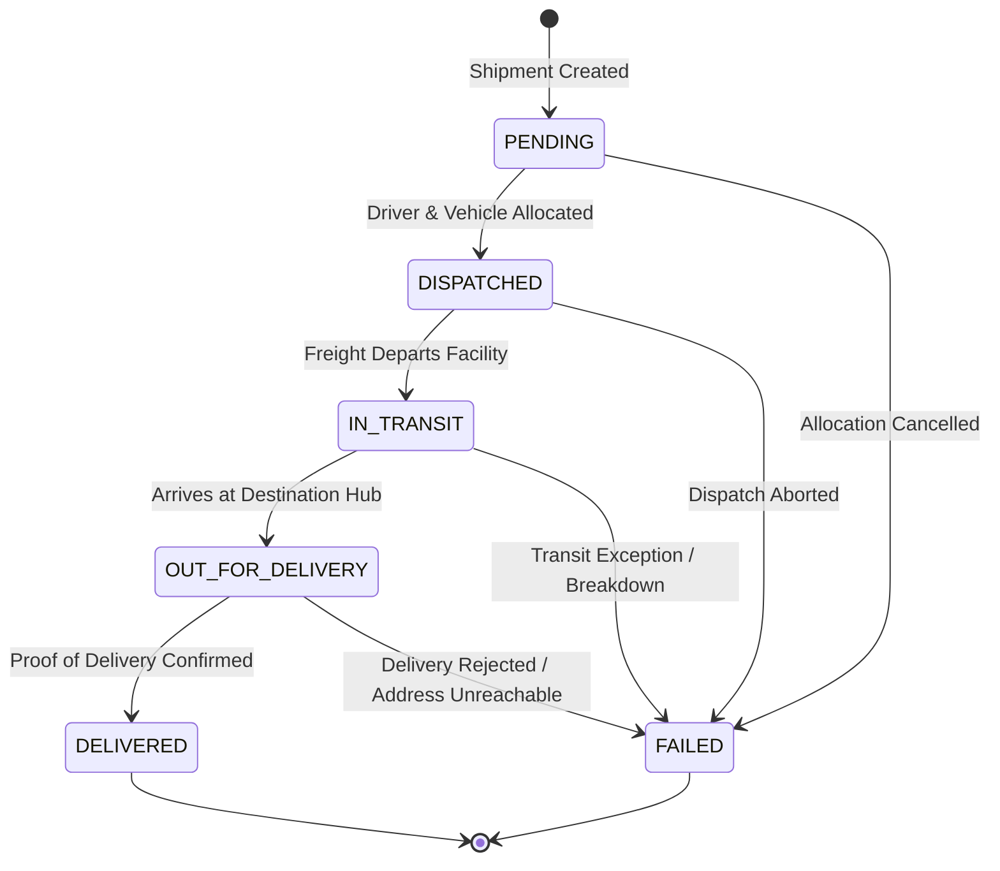

# FlowGrid — System Architecture Specification

> **Decoupled Monolith with Layered Backend Governance & Control Tower UI**  
> *Status:* Production Baseline • *Updated:* October 2026 • *Location:* `docs/ARCHITECTURE.md`

---

## 1. Architectural Overview

**FlowGrid** is engineered as a high-performance **modular decoupled monolith** consisting of:

```text
┌────────────────────────────────────────────────────────────────────────┐
│                        FLOWGRID CONTROL TOWER                          │
│                                                                        │
│   React 18 SPA + Vite  •  Design System Tokens  •  HTML5/CSS Glass     │
│   ├── Top Navigation (Health Monitor • Global Search • Notifications)  │
│   ├── Executive Telematics Dashboard & Interactive SVG Corridor Map    │
│   ├── Shipment Rescue Center (Deterministic Operational Rules)         │
│   ├── What-If Disruption Simulator (Client Sandbox Engine)             │
│   └── Grounded Logistics Assistant Modal & Chat Interface              │
└───────────────────────────────────┬────────────────────────────────────┘
                                    │  Bearer JWT (HTTP/1.1 REST)
                                    │  RFC 6455 WebSocket Telematics
                                    ▼
┌────────────────────────────────────────────────────────────────────────┐
│                         FASTAPI GATEWAY & API                          │
│                                                                        │
│   FastAPI 0.110+  •  Pydantic v2 Schemas  •  OAuth2 Password Bearer    │
│   ├── /api/v1/auth (Login, Registration, RBAC Dependencies)            │
│   ├── /api/v1/shipments (Lifecycle State Machine, Manifests)           │
│   ├── /api/v1/warehouses, /inventory, /drivers, /vehicles, /routes     │
│   ├── /api/v1/analytics (Fleet KPIs, Risk Heuristics)                  │
│   └── /api/v1/ml/predict-delay (Scikit-Learn Joblib Pipeline)          │
└───────────────────┬────────────────────────────────┬───────────────────┘
                    │                                │
                    ▼                                ▼
       ┌─────────────────────────┐      ┌─────────────────────────┐
       │   SQLAlchemy 2.0 ORM    │      │ Scikit-Learn Pipeline   │
       │   Alembic DB Migrations │      │ Random Forest Model     │
       │   PostgreSQL 15+ Engine │      │ Feature Preprocessor    │
       └─────────────────────────┘      └─────────────────────────┘
```

---

## 2. Verified Technology Stack

| Tier | Technology | Version | Purpose |
| :--- | :--- | :--- | :--- |
| **Backend Runtime** | Python | 3.11+ | Asynchronous backend execution runtime |
| **Web Framework** | FastAPI | `>=0.110.0` | High-speed ASGI framework with automated OpenAPI docs |
| **ASGI Server** | Uvicorn | `>=0.28.0` | Lightning-fast asynchronous HTTP & WebSocket server |
| **ORM & Data Layer** | SQLAlchemy | `>=2.0.0` | Declarative mapping, connection pooling, typed models |
| **Database Driver** | psycopg3 | `>=3.1.18` | High-throughput PostgreSQL driver (`psycopg[binary]`) |
| **Schema Migrations**| Alembic | `>=1.13.0` | Version-controlled database migrations |
| **Authentication** | Argon2id & PyJWT | `>=0.2.0` / `>=2.8.0` | Password hashing & HMAC-SHA256 JWT tokens |
| **Machine Learning** | Scikit-Learn | `>=1.4.0` | Random Forest delay prediction pipeline (`joblib`) |
| **Frontend Framework**| React | `^19.2.8` | Component rendering, state hooks, and UI reactive views |
| **Build & Dev Tool** | Vite | `^8.3.0` | Instant HMR and optimized production asset bundling |
| **Geographic Maps** | Leaflet | `^1.9.4` | Interactive waypoint and corridor mapping |
| **Automated Testing**| pytest & Node Test | `>=8.0.0` / Native | Pytest backend suite + 46 frontend unit/integration tests |

---

## 3. Backend Request Lifecycle & Layered Architecture

FlowGrid enforces a strict separation of concerns across every HTTP request:

```text
HTTP Request / WebSocket
       │
       ▼
[ Middleware & Security Headers ] (CORS, ProcessTimeHeader, Security)
       │
       ▼
[ FastAPI Routers ] (Route paths, Pydantic v2 Schema Validation)
       │
       ▼
[ Dependencies Layer ] (JWT Decoding, get_current_user, require_roles)
       │
       ▼
[ Service Layer ] (ShipmentService, State Machine Invariants, Capacity Checks)
       │
       ▼
[ Repository Layer ] (Optimized Queries, Joins, Filters, Soft-Deletes)
       │
       ▼
[ SQLAlchemy 2.0 ORM Models ] (Entity Declarations, Table Mappings)
       │
       ▼
[ PostgreSQL Database ] (ACID Compliance, Indexes, Foreign Keys)
```

### Core Invariants
1. **Never query the database from route controllers**: Always route queries through the repository layer.
2. **Never bypass the state machine**: All shipment status modifications must execute via `ShipmentService.update_shipment_status()`.
3. **Always validate carrying capacity**: Payload weight is checked against vehicle capacity ratings prior to dispatch.

---

## 4. Frontend Architecture & Design System

The React frontend operates as an operations cockpit designed for speed, visibility, and responsiveness:

### 4.1 State Management & Context Providers
- `AuthContext`: Manages authenticated session tokens, decoded operator role claims, and automatic token refresh.
- `NotificationContext`: Collects real-time alerts, derives unread counters, and deduplicates identical warnings.
- `ToastContext`: Displays global operational feedback banners across dispatch workflows.

### 4.2 Top Navigation Bar (`TopNavbar.jsx`)
- **Real-Time Backend Monitor**: Direct `/health` probe indicating live connectivity and telematics health.
- **Global Multi-Entity Search**: Instant search filtering across active shipments, facilities, and drivers.
- **Persistent Theme Switcher**: Toggles dark mode (`#0B1220`) and light mode (`#F1F5F9`) with dynamic Sun/Moon iconography and zero-flash `<head>` script loader.

### 4.3 Control Tower Views
- **Executive Dashboard**: SVG corridor telematics map with pulsing halos, 4 KPI cards, and recent shipments table.
- **Shipment Rescue Center**: Triage table displaying deterministic rules (`RULE-EX01`, `RULE-R01` to `RULE-R04`) with interactive resolution drawers.
- **What-If Disruption Simulator**: Non-destructive client-side simulation engine modeling driver shortages, corridor closures, facility saturation, and fuel surcharges.
- **Grounded Logistics Assistant**: Slide-out chat assistant querying authenticated backend APIs for real-time answers.

---

## 5. Shipment Lifecycle State Machine



Every transition automatically generates an immutable audit record in `ShipmentStatusHistory` capturing the old status, new status, timestamp, and operator identifier.

---

## 6. Machine Learning Delay Prediction Subsystem

```text
Incoming Feature Payload
(Distance, Cargo Weight, Vehicle Capacity, Driver Hours, Weather, Traffic)
       │
       ▼
POST /api/v1/ml/predict-delay (Bearer Authenticated)
       │
       ▼
Scikit-Learn Pipeline (`rf_pipeline.joblib`)
├── Numerical Imputer & StandardScaler
├── One-Hot Categorical Encoder
└── Random Forest Classifier
       │
       ▼
Prediction Output
{
  "is_delayed": true,
  "confidence": 0.78,
  "risk_category": "HIGH",
  "governance_disclaimer": "Experimental decision-support prototype."
}
```

- **Pipeline Artifact**: Serialized `rf_pipeline.joblib` loaded on startup in `backend/app/api/v1/ml.py`.
- **Governance Notice**: Documented as an experimental decision-support prototype requiring human confirmation.

---

## 7. Testing & Verification

- **Frontend Suite**: `npm test` runs 46 automated unit and integration tests covering API clients, CSV sanitization, geo-coordinates, notification deduplication, and live FastAPI health probes.
- **Backend Suite**: `pytest` validates JWT authentication, RBAC boundaries, state machine transition invariants, capacity checks, and ML prediction endpoints.
- **Build Quality**: `npm run build` compiles clean production assets with zero bundle errors.
