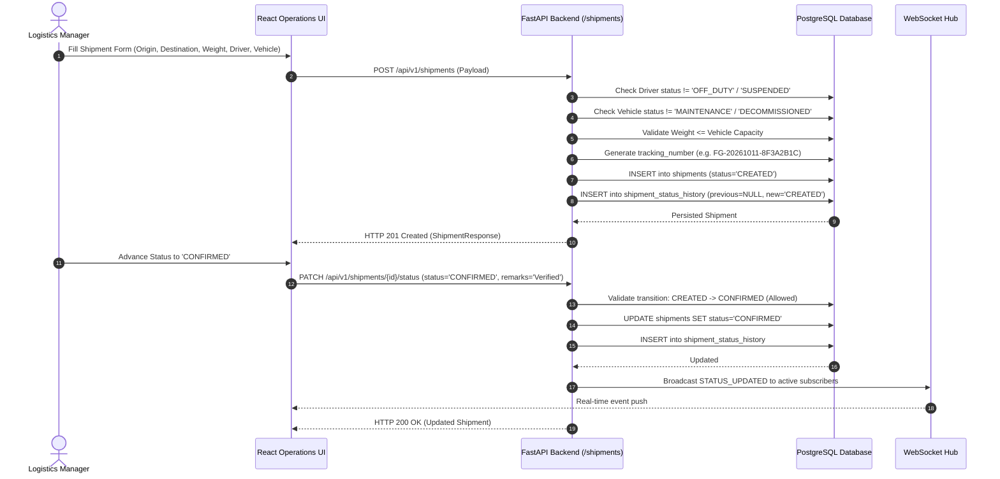
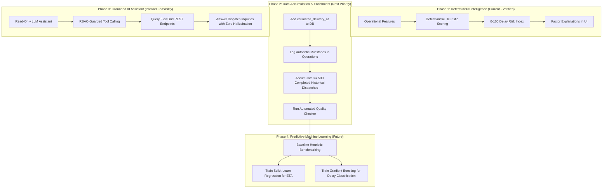

# FlowGrid — Product Requirements Document (PRD)
**Smart Logistics & Transportation Management Platform (Control Tower)**

*Document Version:* 1.0.0  
*Status:* Verified & Authoritative Baseline  
*Last Updated:* October 2026  
*Primary Technical Reference:* FlowGrid Decoupled Monolith (`backend/` + `frontend/`)

---

## Table of Contents
1. [Product Overview](#1-product-overview)
2. [Problem Statement & Real-World Logistics Challenges](#2-problem-statement--real-world-logistics-challenges)
3. [Product Vision & Long-Term Direction](#3-product-vision--long-term-direction)
4. [Target Users & Stakeholder Personas](#4-target-users--stakeholder-personas)
5. [User Roles & RBAC Matrix](#5-user-roles--rbac-matrix)
6. [Core Use Cases & User Stories](#6-core-use-cases--user-stories)
7. [Existing End-to-End Operational Workflows](#7-existing-end-to-end-operational-workflows)
8. [Functional Requirements by Module](#8-functional-requirements-by-module)
9. [Non-Functional Requirements](#9-non-functional-requirements)
10. [Business Rules & Operational Constraints](#10-business-rules--operational-constraints)
11. [Current Implementation Baseline vs. Planned Capabilities](#11-current-implementation-baseline-vs-planned-capabilities)
12. [AI/ML Roadmap & Data Readiness](#12-aiml-roadmap--data-readiness)
13. [Acceptance Criteria for Major Features](#13-acceptance-criteria-for-major-features)
14. [Success Metrics & KPI Calculations](#14-success-metrics--kpi-calculations)
15. [Scope Boundaries & Explicit Non-Goals](#15-scope-boundaries--explicit-non-goals)
16. [Assumptions, Limitations & Unresolved Questions](#16-assumptions-limitations--unresolved-questions)

---

## 1. Product Overview

**FlowGrid** is an enterprise-grade, intelligent logistics and transportation management platform designed as an **Operational Logistics Control Tower**. It centralizes physical facility oversight, fleet allocation, inventory monitoring, commercial freight lifecycle execution, transit corridor routing, real-time shipment telemetry, and operational analytics.

Unlike standard static CRUD inventory trackers or disconnected dispatch sheets, FlowGrid operates around a strictly governed finite state machine (`ShipmentStatus`), real-time bi-directional telemetry via WebSockets, an immutable lifecycle transition audit trail (`ShipmentStatusHistory`), and deterministic, explainable delay-risk intelligence.

The platform provides a production-structured backend built on **FastAPI** and **SQLAlchemy 2.0** paired with a responsive, high-density operations frontend built on **React 19** and **Vite**, themed in an operational "Deep Tech Blue" aesthetic.

---

## 2. Problem Statement & Real-World Logistics Challenges

Mid-market logistics providers, regional 3PLs (Third-Party Logistics), and distribution networks face critical operational hurdles:

1. **Fragmented Operational Visibility (The "Black Box" Dispatch)**:
   Once cargo departs a fulfillment center, dispatchers lose visibility until physical drop-off. Status updates are delayed, siloed in telephone calls, or recorded inconsistently.
2. **State Transition Anarchy**:
   Conventional logistics systems allow arbitrary status overrides (e.g., jumping from `CREATED` directly to `DELIVERED`, or modifying cargo weight after a delivery is completed), corrupting auditability and operational integrity.
3. **Equipment & Driver Mismatches**:
   Dispatchers frequently assign cargo to inactive drivers, drivers who are off-duty, or vehicles undergoing maintenance. Freight weight often exceeds vehicle payload ratings without automated validation.
4. **Reactive Rather than Proactive Exception Handling**:
   Logistics operators discover delivery delays only after a promised window has expired. Without explainable operational risk indicators (identifying unassigned drivers, overloaded equipment, interstate routing, or facility congestion), preventative intervention is impossible.
5. **Superficial "AI Hype" vs. Grounded Operational Data**:
   Industry tools frequently market statistical machine learning models claiming 99% ETA accuracy while operating on unvalidated, synthetic, or sparse data lacking true historical milestone timestamps.

FlowGrid directly resolves these challenges by enforcing strict state machine invariants, real-time checkpoint auditing, asset allocation safety rules, and transparent, rule-grounded risk intelligence.

---

## 3. Product Vision & Long-Term Direction

FlowGrid is engineered to become an **Intelligent Logistics Control Tower**:
A centralized operations center where logistics managers, dispatchers, and fleet operators can:
- **Inspect Shipment Readiness**: Instantly evaluate whether a shipment has verified origin facilities, assigned active drivers, and compatible transport units.
- **Detect Operational Risk Pre-Dispatch & In-Transit**: Surface deterministic risk scores (0–100) that point out exactly why a shipment is endangered (e.g., missing asset allocation, vehicle at 92% weight capacity, origin warehouse at 95% capacity saturation).
- **Coordinate Real-Time Exceptions**: Broadcast checkpoint arrivals and status transitions instantly via WebSockets to connected dashboards and field personnel.
- **Progress Safely to Machine Learning**: Build upon an anti-leakage ML feature extraction pipeline (`backend/app/pipeline/`) to collect authentic historical milestones before training predictive continuous regression or classification models.

---

## 4. Target Users & Stakeholder Personas

| Persona | Title | Context & Pain Points | Primary Goals in FlowGrid |
| :--- | :--- | :--- | :--- |
| **Marcus Vance** | Logistics Operations Director (Admin) | Manages multiple fulfillment centers; needs network-wide compliance, user role security, and system auditing. | Configure facilities, manage user permissions, monitor fleet KPIs, soft-delete decommissioned assets. |
| **Elena Rostova** | Dispatch & Warehouse Coordinator (Manager) | Coordinates daily outbound manifests, assigns routes, balances warehouse stock, and resolves stuck shipments. | Create shipments, assign drivers and vehicles within capacity limits, transition shipment lifecycle states, log checkpoint events. |
| **Alex Rivera** | Field Transport Specialist (Driver) | Operates commercial vehicles on transit corridors; needs simple, reliable visibility into assigned loads. | Inspect assigned shipments, verify delivery addresses, review transit corridor milestones, report operational progress. |
| **Samantha Reed** | Corporate Auditor / Client Representative (Viewer) | Requires read-only oversight of freight delivery integrity, compliance logs, and on-time performance. | Track shipments by tracking number, view immutable status change histories, evaluate delivery performance analytics without edit rights. |

---

## 5. User Roles & RBAC Matrix

FlowGrid implements strict Role-Based Access Control verified through the `UserRole` enum (`backend/app/models/user.py`) and enforced in backend route dependencies (`require_roles` in `backend/app/api/deps.py`):

| Module / Action | HTTP Method & Resource | Admin | Manager | Driver | Viewer | Enforced In Code |
| :--- | :--- | :---: | :---: | :---: | :---: | :--- |
| **User Registration** | `POST /api/v1/auth/register` | Open* | Open* | Open* | Open* | Public endpoint; defaults to `VIEWER` or requested role |
| **User Authentication** | `POST /api/v1/auth/login` | Yes | Yes | Yes | Yes | Validates active status & password hash |
| **Own Profile** | `GET /api/v1/auth/me` | Yes | Yes | Yes | Yes | Requires valid Bearer JWT |
| **Warehouse Facility CRUD** | `POST, PUT, PATCH /warehouses` | Allowed | Allowed | Denied (403) | Denied (403) | `require_roles([ADMIN, MANAGER])` |
| **Warehouse Deletion** | `DELETE /warehouses/{id}` | Allowed | Denied (403) | Denied (403) | Denied (403) | `require_roles([ADMIN])` (Soft-delete) |
| **Warehouse Read** | `GET /warehouses`, `GET /warehouses/{id}` | Allowed | Allowed | Allowed | Allowed | Authenticated users |
| **Product Catalog CRUD** | `POST, PUT, PATCH /products` | Allowed | Allowed | Denied (403) | Denied (403) | `require_roles([ADMIN, MANAGER])` |
| **Product Deletion** | `DELETE /products/{id}` | Allowed | Denied (403) | Denied (403) | Denied (403) | `require_roles([ADMIN])` (Soft-delete) |
| **Product Read** | `GET /products`, `GET /{id}` | Allowed | Allowed | Allowed | Allowed | Authenticated users |
| **Inventory Stock Adjust** | `POST, PUT, PATCH /inventory` | Allowed | Allowed | Denied (403) | Denied (403) | `require_roles([ADMIN, MANAGER])` |
| **Inventory Deletion** | `DELETE /inventory/{id}` | Allowed | Denied (403) | Denied (403) | Denied (403) | `require_roles([ADMIN])` |
| **Driver Profile Management** | `POST, PUT, PATCH /drivers` | Allowed | Allowed | Denied (403) | Denied (403) | `require_roles([ADMIN, MANAGER])` |
| **Driver Read** | `GET /drivers`, `GET /{id}` | Allowed | Allowed | Allowed | Allowed | Authenticated users |
| **Vehicle Fleet CRUD** | `POST, PUT, PATCH /vehicles` | Allowed | Allowed | Denied (403) | Denied (403) | `require_roles([ADMIN, MANAGER])` |
| **Vehicle Deletion** | `DELETE /vehicles/{id}` | Allowed | Denied (403) | Denied (403) | Denied (403) | `require_roles([ADMIN])` |
| **Shipment Creation** | `POST /shipments` | Allowed | Allowed | Denied (403) | Denied (403) | `require_roles([ADMIN, MANAGER])` |
| **Shipment Modification** | `PUT, PATCH /shipments/{id}` | Allowed | Allowed | Denied (403) | Denied (403) | Blocked if `DELIVERED`, `CANCELLED`, `RETURNED` |
| **Shipment Status Transition**| `PATCH /shipments/{id}/status` | Allowed | Allowed | Denied (403)**| Denied (403) | State machine verified; audit log saved |
| **Shipment Soft-Delete** | `DELETE /shipments/{id}` | Allowed | Denied (403) | Denied (403) | Denied (403) | `require_roles([ADMIN])` sets `is_active=False` |
| **Add Tracking Checkpoint** | `POST /shipments/{id}/tracking`| Allowed | Allowed | Denied (403) | Denied (403) | `require_roles([ADMIN, MANAGER])` |
| **View Tracking & History** | `GET /shipments/{id}/history`, `/tracking` | Allowed | Allowed | Allowed | Allowed | Authenticated users |
| **Route Management** | `POST, PUT, PATCH /routes` | Allowed | Allowed | Denied (403) | Denied (403) | `require_roles([ADMIN, MANAGER])` |
| **Assign Route Shipments** | `POST /routes/{id}/shipments` | Allowed | Allowed | Denied (403) | Denied (403) | `require_roles([ADMIN, MANAGER])` |
| **Analytics & KPIs** | `GET /analytics/*` (all 9 endpoints) | Allowed | Allowed | Allowed | Allowed | Authenticated users |
| **Delay Risk Evaluation** | `GET /analytics/delay-risk` | Allowed | Allowed | Allowed | Allowed | Authenticated users |
| **AI Data Pipeline & Export**| `GET /pipeline/*` | Allowed | Allowed | Denied (403) | Denied (403) | `require_roles([ADMIN, MANAGER])` |
| **Live WebSocket Telemetry** | `WS /ws/tracking/{shipment_id}`| Allowed | Allowed | Assigned Only | Allowed | Token verified; connection pool capped |

*\*Note on Registration: While `POST /api/v1/auth/register` accepts a role field in the schema, in production environments role escalation must be restricted to administrators.*  
*\*\*Note on Driver Status Updates: In the verified backend implementation, `PATCH /shipments/{id}/status` requires `ADMIN` or `MANAGER`. Mobile-driver self-reporting transitions via dedicated scoped driver credentials represent a planned future capability.*

---

## 6. Core Use Cases & User Stories

### Use Case 1: Freight Dispatch & Capacity Safety
- **As a** Logistics Manager,
- **I want to** register an outbound shipment, allocate an available driver, and assign a transport vehicle,
- **So that** cargo is not assigned to unavailable personnel and cargo weight does not exceed the vehicle's licensed maximum weight capacity.
- **Enforcement**: If `total_weight_kg > vehicle.capacity`, the API immediately rejects the request with HTTP 400 Bad Request.

### Use Case 2: Auditable State Machine Transition
- **As a** Dispatcher or System Auditor,
- **I want to** progress a shipment through valid lifecycle states with obligatory audit remarks,
- **So that** shipments cannot skip steps (e.g. `CREATED` cannot jump directly to `OUT_FOR_DELIVERY`), and every status change creates an immutable `ShipmentStatusHistory` record capturing the timestamp and user ID.

### Use Case 3: Real-Time Checkpoint Telemetry
- **As a** Client Stakeholder or Support Specialist,
- **I want to** observe physical milestone scans (e.g. `DEPARTURE_FACILITY`, `IN_TRANSIT_WEIGH_STATION`) as they occur,
- **So that** I receive live WebSocket push notifications and map updates without polling the server.

### Use Case 4: Operational Delay-Risk Triage
- **As an** Operations Lead,
- **I want to** query explainable delay-risk scores across the active fleet,
- **So that** I can identify high-risk shipments before failure occurs, understanding whether the risk originates from missing drivers, vehicle weight strain, interstate distances, or warehouse congestion.

---

## 7. Existing End-to-End Operational Workflows

### 7.1 Shipment Creation & Dispatch Lifecycle

### 7.2 Physical Checkpoint Event Capture

1. Shipment is actively `IN_TRANSIT`.
2. Manager or Admin submits checkpoint coordinates and remarks via `POST /api/v1/shipments/{id}/tracking`.
3. System verifies shipment existence and active status.
4. System inserts record into `shipment_tracking_events` (`event_type`, `location`, `description`, `timestamp`, `created_by_user_id`).
5. ConnectionManager broadcasts `TRACKING_EVENT_ADDED` via WebSocket to all clients viewing that shipment.
6. The frontend `ShipmentDetailDrawer` and `ShipmentRouteMap` update dynamically without page reloads.

---

## 8. Functional Requirements by Module

### 8.1 Authentication & Authorization
- **FR-AUTH-01**: Secure registration via email, full name, role, and password (`POST /api/v1/auth/register`).
- **FR-AUTH-02**: Passwords must be hashed using state-of-the-art **Argon2id** via `pwdlib`. Plain-text passwords or hashes must never be returned in API responses.
- **FR-AUTH-03**: Stateless authentication using signed JSON Web Tokens (JWT) using HMAC-SHA256 (`POST /api/v1/auth/login`).
- **FR-AUTH-04**: Role-Based Access Control enforced on every endpoint according to the RBAC matrix.
- **FR-AUTH-05**: Deactivated accounts (`is_active=False`) must be rejected at login and token validation with HTTP 400.

### 8.2 Warehouse Facilities
- **FR-WH-01**: Maintain warehouse hubs with name, location (e.g. "Chicago, IL"), address, square footage capacity, and active status.
- **FR-WH-02**: Unique primary key identification. Soft-deletion sets `is_active=False` rather than destroying relational records.
- **FR-WH-03**: Read endpoints support pagination (`skip`, `limit`) and active status filtering.

### 8.3 Products Catalog
- **FR-PROD-01**: Maintain commercial goods catalog with name, unique SKU (`sku`), description, unit price (`unit_price`), and active flag.
- **FR-PROD-02**: Case-insensitive uniqueness enforcement on SKUs.
- **FR-PROD-03**: Soft-deletion supported by Admin.

### 8.4 Inventory Management
- **FR-INV-01**: Track on-hand physical inventory balances linking `product_id` and `warehouse_id`.
- **FR-INV-02**: Enforce unique constraint `uq_warehouse_product`: a warehouse cannot have multiple records for the same product.
- **FR-INV-03**: Configurable safety reorder threshold (`reorder_level`).
- **FR-INV-04**: Inventory level queries support filtering by warehouse and product.

### 8.5 Field Drivers
- **FR-DRV-01**: Driver profiles extend a User account (1-to-1 relationship) with commercial license number (`license_number`), phone number, and operational availability status (`availability_status`).
- **FR-DRV-02**: Driver availability status enum: `AVAILABLE`, `ON_DUTY`, `IN_TRANSIT`, `OFF_DUTY`, `SUSPENDED`.
- **FR-DRV-03**: Uniqueness constraint on driver license numbers.
- **FR-DRV-04**: Assignment guard: Drivers with status `OFF_DUTY` or `SUSPENDED`, or with deactivated user accounts, cannot be assigned to shipments.

### 8.6 Fleet Vehicles
- **FR-VEH-01**: Manage transport units with registration plate/identifier (`registration_number`), vehicle type (e.g. `Van`, `Semi-Trailer`, `Box Truck`, `Flatbed`), maximum weight capacity in kilograms (`capacity`), and maintenance status (`status`).
- **FR-VEH-02**: Vehicle status values: `AVAILABLE`, `IN_USE`, `MAINTENANCE`, `DECOMMISSIONED`.
- **FR-VEH-03**: Uniqueness constraint on registration numbers.
- **FR-VEH-04**: Assignment guard: Vehicles in `MAINTENANCE` or `DECOMMISSIONED` status cannot be assigned to shipments.
- **FR-VEH-05**: Weight capacity guard: Cargo weight cannot exceed vehicle capacity.

### 8.7 Shipments & Lifecycle State Machine
- **FR-SHP-01**: Maintain commercial shipments with tracking number, origin warehouse, consignee address/city/state/postal code, status, driver ID, vehicle ID, total weight, total volume, scheduled pickup, and delivered timestamp.
- **FR-SHP-02**: System automatically generates collision-free tracking numbers in the format `FG-YYYYMMDD-XXXXXXXX` if none is supplied.
- **FR-SHP-03**: Strict enforcement of `ALLOWED_TRANSITIONS` state machine.
- **FR-SHP-04**: Prevent updating delivered, cancelled, or returned shipments.
- **FR-SHP-05**: Soft deletion preserves historical integrity (`is_active=False`).

### 8.8 Tracking & Status Audit Trail
- **FR-TRK-01**: Every status change atomically creates a row in `shipment_status_history` capturing `previous_status`, `new_status`, `changed_by_user_id`, `remarks`, and UTC timestamp.
- **FR-TRK-02**: Append physical checkpoint scans to `shipment_tracking_events` with location, event type, and description.
- **FR-TRK-03**: Provide consolidated `GET /shipments/{id}/tracking/latest` summarizing current state and latest milestone.
- **FR-TRK-04**: Real-time push via WebSocket `/ws/tracking/{shipment_id}` with per-shipment and global connection limit guards.

### 8.9 Transit Corridors & Routes
- **FR-RTE-01**: Manage corridors with name, origin, destination, estimated distance (km), estimated duration (hours), and status (`ACTIVE`, `INACTIVE`, `PLANNED`, `COMPLETED`, `CANCELLED`).
- **FR-RTE-02**: Link multiple shipments to a route via `route_shipments` association table with uniqueness constraint `uq_route_shipment`.

### 8.10 Analytics & Operational KPIs
- **FR-ANL-01**: Real-time KPI aggregation across 9 dedicated endpoints: Overview, Shipments, Inventory, Warehouses, Routes, Drivers, Vehicles, and Delay-Risk.
- **FR-ANL-02**: Mathematical formulas protected by division-by-zero guards.
- **FR-ANL-03**: Support optional `start_date` and `end_date` date filtering.

### 8.11 Explainable Delay-Risk Intelligence
- **FR-RSK-01**: Deterministic scoring (0–100) evaluating:
  - Driver unassigned (+25)
  - Vehicle unassigned (+20)
  - Route unassigned (+15)
  - Vehicle capacity strain (>=90% capacity: +15, >=75%: +10)
  - Interstate transit (+10)
  - Origin warehouse capacity congestion (>=90% capacity: +10, >=75%: +5)
- **FR-RSK-02**: Clamped between 0 and 100. Categorized into `LOW` (0–29), `MEDIUM` (30–59), `HIGH` (60–79), and `CRITICAL` (80–100).
- **FR-RSK-03**: Completed shipments (`DELIVERED`, `CANCELLED`, `RETURNED`) cleanly return risk score 0.
- **FR-RSK-04**: Transparently outputs `is_calibrated_probability=False` and `assessment_method="DETERMINISTIC_HEURISTIC"`.

### 8.12 AI-Ready Data Pipeline
- **FR-PIP-01**: PII-redacted feature extraction (`RAW_FEATURE`, `DERIVED_FEATURE`, `TARGET_VARIABLE`, `DEFERRED`).
- **FR-PIP-02**: Strict data leakage quarantine: active/undelivered shipments must have `None` for target variables (`actual_duration_hours`, `is_delayed`, `delay_hours`).
- **FR-PIP-03**: Chronological train/test splitting and RFC 4180 CSV export.

---

## 9. Non-Functional Requirements

### 9.1 Security
- Password storage using modern Argon2id (memory cost 64MB, time cost 3 iterations).
- Stateless JWT tokens with HMAC-SHA256 and configurable expiration (default 24 hours).
- HTTP Security Hardening Headers injected on all responses:
  - `X-Content-Type-Options: nosniff`
  - `X-Frame-Options: DENY`
  - `X-XSS-Protection: 1; mode=block`
  - `Strict-Transport-Security` (in non-debug environments)
- PII Sanitization: Redacts emails, phone numbers, driver personal data, and hashed passwords from ML exports and tracking logs.

### 9.2 Reliability & Fault Tolerance
- Global exception handlers intercept `SQLAlchemyError` and runtime `Exception` to prevent database schema and Python stack trace leakage.
- Atomic database transactions: Multi-step status transitions rollback automatically on failure.
- WebSocket connection safety: Capped at 50 concurrent connections per shipment and 1,000 globally to prevent Denial of Service.

### 9.3 Performance
- Fast response latencies: Database indexes configured on all foreign keys, status enums, tracking numbers, and timestamps.
- Response timing header `X-Process-Time-Ms` injected on every HTTP response.
- Lightweight frontend bundle via Vite without heavy third-party UI framework bloat.

### 9.4 Maintainability & Clean Architecture
- Layered separation of concerns: Routers (`app/api/`) $\to$ Services (`app/services/`) $\to$ Repositories (`app/repositories/`) $\to$ Models (`app/models/`).
- 100% Python type hints across all function signatures.
- Pydantic v2 schemas for all request validations and response serializations.

### 9.5 Data Integrity
- Foreign keys enforced across all relational connections with explicit `ondelete` strategies (`CASCADE` or `SET NULL`).
- Database migration history version-controlled through Alembic.
- Zero-drift between SQLAlchemy models and PostgreSQL database schema.

---

## 10. Business Rules & Operational Constraints

1. **State Machine Invariant**: Status transitions can only follow the directed graph defined in `ALLOWED_TRANSITIONS`. Terminal states cannot transition to any other status.
2. **Terminal Immutability**: Shipments in `DELIVERED`, `CANCELLED`, or `RETURNED` cannot have their cargo, destination, driver, or vehicle details altered.
3. **Vehicle Capacity Invariant**: Under no circumstance may a shipment be assigned or updated if `total_weight_kg > vehicle.capacity`.
4. **Driver Availability Invariant**: Drivers marked `OFF_DUTY` or `SUSPENDED` are disqualified from dispatch assignments.
5. **Inventory Balance Invariant**: Stock quantities on hand cannot be negative.
6. **No Fake Historical Data**: Real operational analytics and AI metrics must strictly derive from actual persisted database events.

---

## 11. Current Implementation Baseline vs. Planned Capabilities

| Capability / Feature | Module | Current Status | Verification Notes |
| :--- | :--- | :--- | :--- |
| **User Auth & RBAC (Argon2 + JWT)** | Backend / Core | **Implemented & Verified** | 100% verified via automated tests in `test_auth.py`. |
| **Warehouse Management CRUD** | Backend / Frontend | **Implemented & Verified** | CRUD verified; UI verified in `WarehousesPage.jsx`. |
| **Product Catalog Management** | Backend / Frontend | **Implemented & Verified** | SKU uniqueness verified in `test_products.py`. |
| **Inventory Stock Management** | Backend / Frontend | **Implemented & Verified** | Tested in `test_inventory.py`; UI stock adjustments active. |
| **Driver & Vehicle Registries** | Backend / Frontend | **Implemented & Verified** | Tested in `test_drivers.py` and `test_vehicles.py`. |
| **Shipment State Machine** | Backend / Frontend | **Implemented & Verified** | Tested in `test_shipments.py`; 10 transitions verified. |
| **Audit Status History Trail** | Backend / Frontend | **Implemented & Verified** | Tested in `test_tracking.py`; displayed in drawer. |
| **Physical Checkpoint Events** | Backend / Frontend | **Implemented & Verified** | Tested in `test_tracking.py`; UI checkpoint creator active. |
| **Transit Corridors & Routes** | Backend / Frontend | **Implemented & Verified** | Tested in `test_routes.py`; Leaflet maps in UI. |
| **Real-time WebSocket Tracking** | Backend / Frontend | **Implemented & Verified** | Tested in `test_websocket_tracking.py`; hook active in UI. |
| **Executive Analytics & KPIs** | Backend / Frontend | **Implemented & Verified** | 9 endpoints verified in `test_analytics.py`. |
| **Explainable Delay-Risk Scoring** | Backend / Frontend | **Implemented & Verified** | Phase 24.2 complete; 20 tests in `test_delay_risk.py`. |
| **AI Data Pipeline & CSV Export** | Backend | **Implemented & Verified** | Verified in `test_ml_pipeline.py`. |
| **Shipment Line-Item Link to Products**| Backend / DB | **Not Implemented** | Shipments currently track gross weight/volume directly. |
| **Driver Self-Service Portal** | Frontend / Mobile | **Planned** | Dedicated driver-only mobile view. |
| **Continuous ETA Regression ML** | Backend / ML | **Blocked by Data Deficit** | 0 historical completed duration targets exist. |
| **Binary Delay Classification ML** | Backend / ML | **Blocked by Data Deficit** | 0 labeled delay instances exist in database. |
| **Grounded AI Logistics Assistant** | Backend / LLM | **Planned (High Readiness)**| Ready for RAG / tool-calling over existing REST endpoints. |

---

## 12. AI/ML Roadmap & Data Readiness

### 12.1 The Operational Reality: Why ML Models Are Blocked Today
An exhaustive audit of the live development database and pipeline exports (`docs/ai_readiness_and_dataset_audit.md`) established:
- **Total Shipment Records**: Exactly 6 seeded demo shipments.
- **Populated Target Variables**: **0 out of 6 (0.0%)** have `actual_duration_hours`, `is_delayed`, or `delay_hours`.
- **Target Quarantine**: `records_with_targets = 0` and `is_valid_for_training = false`.
- **Timestamp Deficits**: The database schema currently lacks `estimated_delivery_at`. Actual pickup timestamps rely on status history records which were empty in initial seed data.

### 12.2 Phased Intelligent Capabilities Roadmap

1. **Explainable Delay-Risk Scoring (Verified)**:
   Deterministic, transparent risk scoring based on resource allocation, capacity strain, and corridor geography. Requires no historical training data.
2. **Read-Only AI Logistics Assistant (High Feasibility)**:
   An AI assistant using tool-calling over existing FlowGrid REST endpoints (e.g. `/shipments/{id}`, `/analytics/overview`, `/analytics/delay-risk/{id}`) to answer natural-language operational questions while strictly respecting user RBAC permissions.
3. **Statistical Machine Learning (Strictly Blocked)**:
   Continuous ETA regression and binary delay classification will ONLY be trained once authentic operational dispatches accumulate valid milestone timestamps and pass `DataQualityChecker` verification.

---

## 13. Acceptance Criteria for Major Features

### AC-1: Shipment Lifecycle Transition
- [x] Given a shipment in `CREATED`, when a Manager requests transition to `CONFIRMED`, then status updates to `CONFIRMED` and a history row is created.
- [x] Given a shipment in `CREATED`, when a Manager requests transition to `DELIVERED`, then the API rejects the transition with HTTP 400 Bad Request detailing allowed targets (`CONFIRMED`, `CANCELLED`).
- [x] Given a shipment in `DELIVERED`, when any user attempts a status update, then the API rejects the transition as a terminal state.

### AC-2: Driver & Vehicle Allocation Validation
- [x] Given a shipment weighing 10,000 kg, when assigning a vehicle with capacity 8,000 kg, then the API returns HTTP 400 Bad Request with an explicit capacity error message.
- [x] Given a driver with `availability_status = 'OFF_DUTY'`, when assigning to a shipment, then the API returns HTTP 400 Bad Request.

### AC-3: Delay Risk Scoring
- [x] Given an active shipment with no driver, no vehicle, no route, weighing 95% of vehicle capacity, when evaluated by `DelayRiskService`, then the score reflects each individual factor deterministically.
- [x] Given a delivered shipment, when evaluated, then the score is 0 with category `COMPLETED`.

---

## 14. Success Metrics & KPI Calculations

1. **On-Time Delivery Rate (OTD %)**:
   $$\text{OTD Rate} = \frac{\text{Count}(\text{Delivered Shipments with Duration} \le \text{Planned Duration} + 0.1\text{ hrs})}{\text{Total Delivered Shipments}} \times 100\%$$
2. **Delivery Completion Rate**:
   $$\text{Completion Rate} = \frac{\text{Count}(\text{DELIVERED})}{\text{Total Shipments}} \times 100\%$$
3. **Vehicle Capacity Utilization Rate**:
   $$\text{Fleet Utilization} = \frac{\text{Count}(\text{Vehicles with status } \text{'IN\_USE'})}{\text{Total Active Vehicles}} \times 100\%$$
4. **Facility Capacity Saturation**:
   $$\text{Warehouse Saturation} = \min\left(100.0, \frac{\sum \text{Inventory Quantities at Facility}}{\text{Warehouse Capacity}} \times 100\%\right)$$
5. **Delay Prediction Baseline Advantage (Future ML Target)**:
   $$\text{Improvement} = \text{MAE}_{\text{Historical Mean Baseline}} - \text{MAE}_{\text{Model}}$$

---

## 15. Scope Boundaries & Explicit Non-Goals

### In Scope
- Full-stack logistics operations platform (FastAPI backend + React frontend).
- Comprehensive RBAC (Admin, Manager, Driver, Viewer).
- Deterministic finite state machine lifecycle governance.
- Relational inventory, facility, vehicle, driver, and route tracking.
- Real-time WebSocket milestone telemetry.
- Explainable operational delay-risk scoring.
- ML-ready dataset pipeline and quality checking.

### Explicit Non-Goals (Out of Scope for Current Release)
- **Direct Carrier Telematics Hardware Integration**: No OBD-II or GPS hardware communication; positions are ingested via software REST API checkpoints.
- **Payment Processing & Invoicing**: FlowGrid manages physical goods movement and freight custody, not financial billing or payment gateways.
- **Autonomous Dispatch Routing**: System assists human dispatchers with validations and risk scoring; it does not automatically reassign drivers without human approval.
- **Black-Box Deep Learning**: No unexplainable neural networks; all risk assessments must expose transparent contributing factors.

---

## 16. Assumptions, Limitations & Unresolved Questions

1. **Shipment Item Linking**: Current implementation stores `total_weight_kg` and `total_volume_cbm` directly on the `Shipment` entity rather than maintaining a `shipment_items` join table. Adding itemized product manifests is identified as a high-priority future enhancement.
2. **ETA Database Column**: The `Shipment` model currently lacks a dedicated `estimated_delivery_at` timestamp column, relying instead on Route static durations. Adding this column is necessary before training ETA models.
3. **Driver Mobile Client**: Drivers currently use the responsive web frontend. A dedicated progressive web app (PWA) optimized for mobile touchscreens remains a future phase item.
